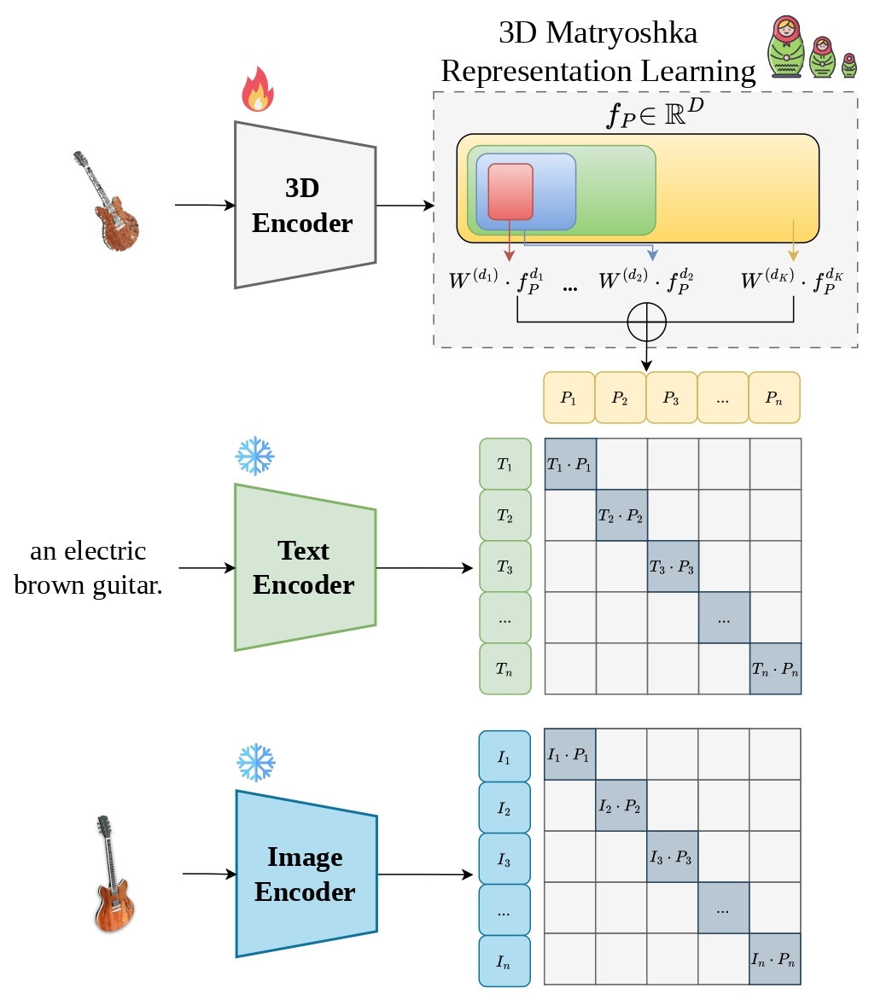

<div align="center">

# 3D-MRL

### Nested Multimodal 3D Representations via Matryoshka Representation Learning

**[Márcus Lobo¹](https://www.linkedin.com/in/marcusvlc/), [Vitor Matias¹](https://vitorpmh.github.io/), [Jeová Farias²](https://jeovafarias.github.io/), and [Moacir Ponti¹](https://sites.google.com/site/moacirponti/)**

[¹Universidade de São Paulo](https://www.icmc.usp.br/), [²Bowdoin College](https://www.bowdoin.edu/)

</div>

<div align="center">


[🌐 project page](https://usmarcv.github.io/3DMRL_page/) | [📃 arXiv](https://arxiv.org/pdf/2608.29285) | [🤗 models](https://huggingface.co/marcusvlc/3D-MRL)

</div>


<!-- <div align="center>


</div> -->

<div style="display: flex; align-items: center; gap: 20px;">
  
  <div>
   Our 3D-MRL learns nested 3D representations by aligning point clouds with frozen CLIP image and text embeddings across multiple dimensionalities. Contrastive supervision is applied to each nested prefix, enabling a single 3D encoder to produce representations from compact to full dimensionality without retraining. At inference, embeddings can be truncated according to the available computational budget, supporting efficient zero-shot recognition and cross-modal retrieval.
  </div>
</div>


🎉 **Accepted at BMVC 2026!** This is official code of "3D-MRL: Nested Multimodal 3D Representations via Matryoshka Representation Learning".


## Installation

If you would to run the inference or training locally, you may need to install the following dependencies:

- (i) Create a conda environment and install [pytorch](https://pytorch.org/get-started/previous-versions/), [MinkowskiEngine](https://nvidia.github.io/MinkowskiEngine/quick_start.html), and [DGL](https://www.dgl.ai/pages/start.html) by the following commands or their official guides:

```bash
conda create -n 3dmrl python=3.9
conda activate 3dmrl
conda install pytorch==1.12.1 torchvision==0.13.1 torchaudio==0.12.1 cudatoolkit=11.3 -c pytorch
pip install -U git+https://github.com/NVIDIA/MinkowskiEngine
conda install -c dglteam/label/cu113 dgl
```

- (ii) Install the following packages:

```bash
pip install huggingface_hub wandb omegaconf torch_redstone einops tqdm open3d 
```

If you have a problem with MinkowskiEngine, we refer you to this [installation guide](https://github.com/UCSC-VLAA/MixCon3D/blob/main/Installation.md) from [MixCon3D](https://github.com/UCSC-VLAA/MixCon3D). Sometimes this [other guide](https://github.com/Julie-tang00/Common-envs-issues/blob/main/Cuda12-MinkowskiEngine) can be helpful for understanding the issues generated by MinkowskiEngine and the CUDA version.

## Dataset Downloading

First, modify the path in the download_data.py. Then, execute the following command to download data from Hugging Face:

```bash
python3 download_data.py
```

The datasets used for experiments are the same as [OpenShape](https://github.com/Colin97/OpenShape_code). Please refer to OpenShape for more details of the data.

## Pre-training 

Run the training by the following command:

```bash
CUDA_VISIBLE_DEVICES=0,1,2,3 torchrun --nproc_per_node=4 --master_port=29001 main.py --config configs/Pre-Training/mrl_pointbert_ensembled.yaml --trial_name 3dmrl_pointbert_ensembled

```

The configs can be found in `configs/Pre-Training` folder. You can also change the settings by passing arguments to the `.yaml` files. You can find the trained models in the `exp` folder.


## Inference

Run the zero-shot evaluation by the following command:

```bash
CUDA_VISIBLE_DEVICES=0,1,2,3 torchrun --nproc_per_node=4 --master_port=29001 test.py --config configs/Pre-Training/mrl_pointbert_ensembled.yaml --resume exp/path/to/checkpoint.pth
```

## Acknowledgement

3D-MRL is built using the awesome [ULIP](https://github.com/salesforce/ULIP), [Point-BERT](https://github.com/Julie-tang00/Point-BERT), [OpenShape](https://github.com/Colin97/OpenShape_code), [Uni3D](https://github.com/baaivision/Uni3D), [TAMM](https://github.com/alanzhangcs/Tamm_Code), [MixCon3D](https://github.com/UCSC-VLAA/MixCon3D) and [DuoDuo CLIP](https://github.com/3dlg-hcvc/DuoduoCLIP).

This work was supported in part by the São Paulo Research Foundation (FAPESP), under grants \#2024/09462-1 and \#2026/01721-3. The authors gratefully acknowledge the Center for Mathematical Sciences Applied to Industry (CeMEAI) for providing computational resources, funded by FAPESP under grant \#2013/07375-0.


## Citation

If you find our code helpful, please cite our paper:


```bib
@misc{lobo20263dmrlnestedmultimodal3d,
      title={3D-MRL: Nested Multimodal 3D Representations via Matryoshka Representation Learning}, 
      author={Márcus Lobo and Vitor Matias and Jeová Farias and Moacir Ponti},
      year={2026},
      eprint={2608.29285},
      archivePrefix={arXiv},
      primaryClass={cs.CV},
      url={https://arxiv.org/abs/2608.29285}, 
}
```
